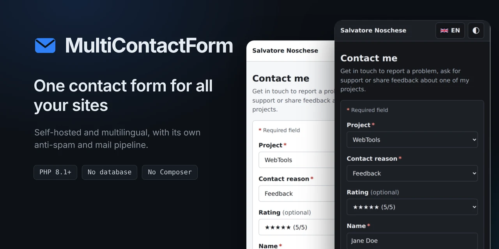
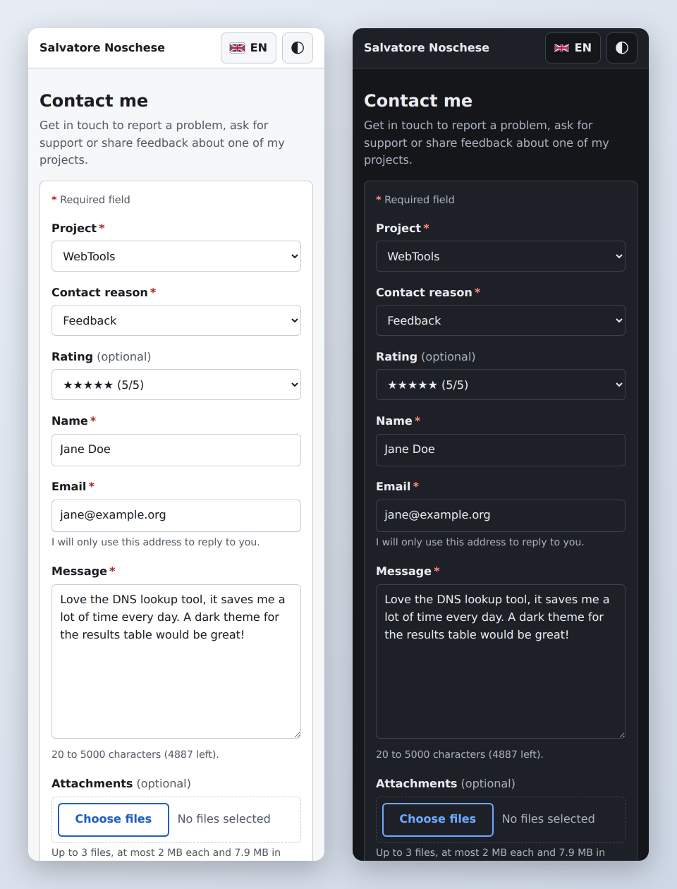

<p align="center">
  
</p>

A self-hosted, multilingual contact form shared by several websites and
projects: one form, one backend, one anti-spam system, one mail pipeline.
Each site simply links to it, with the project preselected by the URL hash:

```html
<a href="https://contact.example.com/#blog">Contact me</a>
<a href="https://contact.example.com/#webtools:feedback">Leave feedback</a>
```

`#project` preselects the project, `#project:reason` also the reason.

No iframe, no database, no Composer, no npm, no CDN, no build step, no
third-party service. Runs on shared hosting too (Brevo API for hosts that
block mail ports).

**Live demo:** <https://contact.salvatorenoschese.it> (configured with
`projects-sample.php`).



## Quick start

1. Upload the folder; point the site's document root to `public/` (or leave
   it in a fixed web root: the root `.htaccess` maps requests into `public/`).
2. `cp config-sample.php config.php` and fill in the values marked REQUIRED.
3. `cp projects-sample.php projects.php` and list your sites.
4. Open the site: the first request creates `_app-data/` next to `config.php`.
5. Link to `https://your-contact-site/#project` from each site.

Details below; `bin/lint.sh`, in the repository, checks your two files
before you upload them.

---

## Requirements

| Component | Minimum |
|-----------|---------|
| PHP | **8.1** or later |
| PHP extensions | `mbstring`, `json`, `openssl` (SMTP over TLS), `fileinfo` (attachments; without it set `attachments.enabled = false`). Optional: `intl` (Unicode normalisation of input) |
| Web server | Apache 2.4 with `mod_rewrite` (`mod_headers` recommended: it sets the security and cache headers of the static files), or nginx |
| HTTPS | Required, also for local development: every cookie is `__Host-`, and the proof-of-work needs a secure context. Over plain HTTP the service does not start (503, the reason in the server log) |
| Data folder | `_app-data/`, created on the first request (PHP needs write access to the installation folder for that), or any path in `data_path` |
| Mail | An SMTP account, or a [Brevo](https://www.brevo.com/) API key (HTTPS on port 443: for hosts that block mail ports). Brevo needs `curl` or `allow_url_fopen` |

The visitor's browser needs JavaScript, Web Workers and the WebCrypto API
(anti-spam proof-of-work) — every current browser has them.

## Features

- **Project context from the URL hash** (`#blog`, `#webtools`, …): project
  preselected, still changeable. The hash is only matched against known
  project ids; unknown values fall back to the generic state.
- **Per-project reasons** from a translated set, each with optional extra
  fields (a one-line topic, a link to the project's own site, a star
  rating, consent to publish the message); "security" warns not to send
  passwords or keys.
- **Errors updated live** after the first attempt; without JavaScript only a
  notice is shown, never a form that cannot work.
- **Languages discovered from `app/lang/`**: English, Italian, Spanish, French and
  German included; add one by dropping in `app/lang/<code>.php`.
- **Light/dark theme** following the device, with a toggle; **language menu**
  with flags. Both remembered in technical cookies written by the server.
- **Optional attachments** with extension whitelist, real-content type check
  and size limits.
- **Privacy page** with a live cookie table (state, value, delete).
- Accessible: real labels, error summary with links to the fields, errors
  announced and tied to their controls, keyboard-friendly menu, visible focus.

## How it works

```
URL hash (#webtools) ──► project preselected (whitelist lookup only)
Language ──► address (/it/) → cookie mcf_lang → Accept-Language → English
Project ──► reasons for that project ──► conditional fields / notices
Submit ──► Origin + CSRF ──► per-client attempt limit ──► honeypot
       ──► min fill time ──► server-side validation (+ attachments)
       ──► proof-of-work ──► per-client and global message limits
       ──► SMTP / Brevo
       ──► "Back to <project>": the page the visitor came from
```

- **Projects** (name, site, reasons) live in `projects.php`; every
  text is in `app/lang/<code>.php`. The backend validates every submission
  against `projects.php`; the page receives a sanitised JSON copy in a
  non-executable `<script type="application/json">` block.
- **Language and theme** are `?lang=` / `?theme=` links: the server writes the
  cookies (1 year, only on explicit choice: from the form's own menu and
  toggle, never from a link, a bookmark or another site),
  because Safari and Brave cap cookies written by `document.cookie` at 7 days.
  With JavaScript the links are called in the background and applied live —
  the form keeps what was typed.
- **No cookie banner needed**: every cookie is strictly technical (CSRF,
  language, theme), and the privacy page explains and lists them.

## Security

| Layer | Implementation |
|-------|----------------|
| CSP | `default-src 'none'; script-src 'self'; style-src 'self' 'nonce-…'; worker-src 'self' blob:; …` — no inline script or style in our markup, no `unsafe-inline` or `unsafe-eval`; the per-response nonce and `blob:` workers are the ALTCHA widget's only exceptions. Plus COOP, CORP, `X-Frame-Options`, `nosniff`, `Referrer-Policy: no-referrer` (except on the service's own redirects, which keep the origin the visitor arrived from, for the way back), `Permissions-Policy`. |
| CSRF | Double-submit cookie (`__Host-mcf_csrf`, `HttpOnly`, `Secure`, `SameSite=Strict`, 4 h idle expiry), compared with `hash_equals`. **No PHP sessions.** The form's issue time travels as an HMAC token bound to the CSRF token (minimum fill time, maximum age). Plus an `Origin` / `Sec-Fetch-Site` check. |
| Anti-spam | Self-hosted **[ALTCHA](https://altcha.org)** proof-of-work with the official library and widget, vendored (v2 protocol, PBKDF2/SHA-256, 5000 iterations per attempt; HMAC-signed parameters and expiry; each solution accepted once), solved while the visitor types, verified with one HMAC. Three levels (`altcha.level`: low, medium, high; high by default). It makes bulk sending costly, it is not a wall. Honeypot (bots get a fake success). Minimum fill time. Without JavaScript the form is not shown. |
| Rate limiting | Sliding window, per client and global, configurable. Per client, attempts (every request, a generous limit against hammering) and messages (valid form, solved challenge) are counted apart, so correcting a field a few times never locks a visitor out. The global limit counts only submissions that passed every other check, proof-of-work included, so junk requests cannot use it up and lock the form for everybody. Keys are keyed hashes of the IP (IPv6 → /64); raw IPs are never stored; entries expire within 24 h, cleaned deterministically. |
| Validation | Every identifier (project, reason, option, field) checked against `projects.php`; fields not belonging to the chosen reason are ignored. Length limits, UTF-8 check, control/bidi characters stripped, request size limits. |
| Mail | Recipient and sender come only from config, and the form never writes to the visitor's address; the subject only from whitelisted labels; Reply-To is a validated bare address; any CR/LF in a header aborts the send. |
| Attachments | Each allowed extension maps to one MIME type, checked against the type **sniffed from the bytes** (fileinfo); max number, per-file and total size, never above `php.ini`. Never written to disk. |
| Links | URL fields accept only `https://` on whitelisted hosts; the fragment is always dropped (for share links it may be a decryption key). The way back is a step in the browser's own history, never an address taken from the request. |
| Refused and missing requests | Served by `ErrorDocument` through `public/error.php`, which only draws the page (the refused file never runs): the address requested, a button back to the form and the footer, in the language of the address (`/es/…`) or else the visitor's. The server's `REDIRECT_STATUS` tells a 403 from a 404. |
| Layout | Only `public/` is web-reachable; code, language files, configuration and data sit one level up. On hosts with a fixed web root the root `.htaccess` maps every request into `public/`. In `public/`: an allow-list of extensions (anything else is 403, `.txt`/`.md` only for licence and readme files), only `index.php`, `submit.php`, `challenge.php`, `privacy.php` and `error.php` execute. Every folder, in `public/` and in `app/`, carries an `index.php` guard (`<?php // Silence...`), and every file in `app/` stops at its guard unless an entry point loaded it. `challenge.php` and `submit.php` answer the form's own requests: opened as a page (typed address, form posted with JavaScript off) they redirect to the form. |
| Configuration | `config.php` and `projects.php` are mandatory and validated at start-up; nothing is generated automatically. Invalid, or a data folder PHP cannot create or write → HTTP 503, reason in the server log only. |

## Installation

1. Create the subdomain (DNS + HTTPS) and point its **document root to
   `public/`**.
2. Copy `config-sample.php` to `config.php`: every setting is there with its
   default. Choose `mail.client` (`'smtp'` or `'brevo'`) and fill in the values
   marked REQUIRED: `site_name`, `secret`
   (`php -r 'echo bin2hex(random_bytes(32));'`), `mail.to`, `mail.from`, the
   SMTP settings or the Brevo API key, `privacy.controller`.
3. Copy `projects-sample.php` to `projects.php` and describe your projects
   (see [Projects](#projects)).
4. Optionally run `bin/lint.sh` from a clone of the repository, where PHP is
   available: it validates your `config.php` and `projects.php` exactly as
   the service will.
5. Open the site and send a test message for each project. The first
   request creates `_app-data/` next to `config.php`: PHP needs write access
   there, or create the folder yourself, writable by PHP.

Until `config.php` and `projects.php` are valid the site answers 503 and the
server log says why.

**Hosts with a fixed web root (e.g. Altervista):** upload the whole project to
the web root as it is. The root `.htaccess` maps every request into `public/`
internally (URLs stay `/`, `/privacy.php`, `/assets/…`) and forces HTTPS on the
original URL. Requires `mod_rewrite`; without it the root `.htaccess` serves
nothing, by design. Behind the host's proxy set `'force_https' => true` if
`X-Forwarded-Proto` does not come from a configured trusted proxy.

**In a subfolder** (`https://example.com/contact/`), either layout works as it
is, except the two `ErrorDocument` lines at the top of `public/.htaccess`:
their path starts at the root of the domain, so write the subfolder in it
(`/contact/error.php`). Otherwise Apache shows its own error page instead of
the form's.

Both layouts were tested on Apache 2.4: pages and assets 200; configuration,
code, language files, data, dotfiles and `README.md` 403/404.

### HSTS

**HSTS is yours to set, not the app's.** `Strict-Transport-Security` applies
to the whole host, not only to the form: sent from here, it would decide for
every other page on the same domain, and two copies of the header (one from
the app, one from the server) leave the browser to obey whichever comes first.
So the form does not send it, and the choice stays with whoever runs the
server. If the site is HTTPS-only, turn it on there, once, for the domain:

```apache
# Apache (.htaccess or vhost), only on HTTPS responses
Header always set Strict-Transport-Security "max-age=31536000" "expr=%{HTTPS} == 'on'"
```

```nginx
# nginx, in the server block that listens on 443
add_header Strict-Transport-Security "max-age=31536000" always;
```

On cPanel it is a switch under **Domains** (HSTS), per domain. Add
`includeSubDomains` only if every subdomain is HTTPS too, and `preload` only
after reading [hstspreload.org](https://hstspreload.org/): leaving the preload
list takes months. Whatever you choose, a browser that has seen the header
refuses plain HTTP, and any certificate warning, for `max-age` seconds.

### Email

Each message reaches `mail.to` as a plain-text email:

- **From:** `Mario Rossi via WebTools <contact@example.com>` — the visitor's
  name and the project in the inbox list (`mail.from_name`), but always your
  own address, so SPF/DKIM pass;
- **Reply-To:** the visitor's address: just press Reply;
- **Subject:** `[WebTools] Feedback — ★★★★☆ (4/5)` (project name, reason, rating);
- **Body:** project, reason, extra fields (consent to publish, where asked,
  always stated: given or not), name, email, the visitor's language, date,
  attachment list, message; files attached.

`mail.language` is the language of the notification **you** receive, not the
visitor's (which is written inside it).

The form never writes to the address the visitor typed: anyone can type
anyone's address, so a copy or a receipt would let strangers make your domain
email third parties. The visitor sees the confirmation on the page; your reply
is the real one.

Delivery — chosen with `mail.client` in `config.php`, which also selects the
matching list of attachment types (`attachments.types.smtp` / `.brevo`):

| Channel | When | Settings |
|---|---|---|
| **`smtp`** | Your mail provider's server | `mail.smtp`: `host`, `port`, `encryption` (`tls` = STARTTLS on 587, `ssl` = implicit TLS on 465), `username`, `password`. Certificates verified; credentials never sent in clear except to localhost. |
| **`brevo`** | Hosts that block outbound mail ports (e.g. Altervista): one HTTPS request on port 443 | `mail.brevo.api_key` (Brevo → SMTP & API → API keys). `mail.from` must be a sender verified in Brevo. Brevo accepts only some attachment types (no webp): the sample's Brevo list respects that, and the service refuses to start with a type Brevo would reject. |

Only the block of the chosen client is validated; the other can stay as it is.

Delivery errors are logged with their technical cause only (e.g.
`Brevo: HTTP 401 … Key not found`), never with the visitor's data; the visitor
sees a generic "could not be sent, try later".

### Behind a proxy / Cloudflare

The rate limiter uses `REMOTE_ADDR`. Behind a reverse proxy set
`client_ip.header` (e.g. `HTTP_CF_CONNECTING_IP`) **and**
`client_ip.trusted_proxies`: single addresses or CIDR ranges, IPv4 and IPv6
(`'173.245.48.0/20'`, `'2400:cb00::/32'`; a CDN publishes its list). The
header is ignored from any other source. If every request appears to come
from the same proxy IP, the per-client limit effectively becomes global. If
the server already restores the visitor's address (Apache `mod_remoteip`,
nginx `real_ip`), leave both settings empty.

### nginx

```nginx
root /path/to/contact/public;     # everything else is outside the web root
location ~ /\.(?!well-known/) { deny all; }
# Pages per language (/es/, /es/privacy.php), as public/.htaccess does.
rewrite ^/[a-z]{2,3}/?$ /index.php last;
rewrite ^/[a-z]{2,3}/privacy\.php$ /privacy.php last;
error_page 403 /error.php;
error_page 404 /error.php;
location ~ \.php$ {
    if ($uri !~ ^/(index|submit|challenge|privacy|error)\.php$) { return 403; }
    # fastcgi_pass …; then, after fastcgi_params, so that error.php tells a
    # 403 from a 404 as it does under Apache:
    fastcgi_param REDIRECT_STATUS $status;
}
client_max_body_size 11m;         # ≥ attachments.max_total_bytes + ~100 KB
```

### Updating

Upload `app/` and `public/` (and the root `.htaccess`) over the old ones;
leave `config.php`, `projects.php` and `_app-data/` where they are. Then run
`bin/lint.sh` on your two files, or open the site: settings a new version no
longer accepts show up as a 503 with the reason in the server log.

## Projects

`projects.php` lists the projects; the key is what follows `#` in the link
(`#webtools`, or `#webtools:feedback` to preselect the reason too):

```php
'webtools' => [
    'name'       => 'WebTools',                        // menu and email subject: "[WebTools] …"
    'site'       => 'https://tools.example.com',       // the project's site
    'reasons'    => [
        'report' => ['url'],                           // + optional link on tools.example.com
        'feature',
        'feedback' => ['rating', 'publish'],           // + optional 1–5 stars, consent to publish
        'privacy',
        'other' => ['text'],                            // + optional one-line topic
    ],
],
```

Reasons are chosen from a fixed set, translated in every language file:
`report`, `support`, `feedback`, `feature`, `collaboration`, `account`,
`security` (with a warning not to send passwords or keys), `abuse`,
`privacy`, `other`. Visitors pick the topic and write the details in the
message.

Optional extra fields per reason: `text` (a one-line topic, up to 100
characters, handy for `other`), `url` (a link on the project's
site, `www.` or not; the part after `#` is removed before sending,
it may hold a private key), `rating` (1–5 stars) and `publish` (a checkbox,
never ticked in advance: the visitor agrees that the message may be
published on your site with the name shortened, e.g. "Mario R.", never the
email address, as on a testimonials page).
With `publish` on any reason, the privacy page gains a section on
publication (consent, Art. 6(1)(a) GDPR, withdrawable).

A visitor who arrives from another site gets a way back to the very page
they came from, in the same tab: "Back to WebTools" ("Back to example.com"
when they came from a site that is not a project's) under the form and
after sending; after sending also by itself, with a live countdown, when
`auto_return` in `config.php` gives the seconds ("Stay here" stops it).
The browser keeps the steps in each history entry's state. From a
bookmark, a typed address, a new tab or a site that sends no referrer there
is nothing to go back to: the button under the form becomes "Reset" (the
page again, as the link in the top bar: what was typed goes, project and
reason too) and after sending there is none.

Mistakes (unknown reasons or keys, a non-https `site`) stop the
service at start-up with the reason in the server log. `projects-sample.php`
is the configuration of the live demo.

## Linking from your sites

```
https://contact.example.com/<lang>/?view=<light|dark>#<project>:<reason>
```

Every part is optional, so a site can carry its context over: a visitor
reading WebTools in German with the light theme lands on the form in German,
light, with WebTools and the reason already chosen. For example, in PHP:

```php
$contact = 'https://contact.example.com/' . $lang . '/'
    . ($theme !== null ? '?view=' . $theme : '')    // the theme your page shows
    . '#webtools:feedback';
```

- `<lang>`: any language in `app/lang/`; without it, or with an unknown one, the
  visitor's own is used. Shown, never stored: the language cookie is written
  only by the form's own menu, so `?lang=` from another site (your
  subdomains included), a bookmark or a typed address just leads to
  `/<lang>/` and is not remembered.
- `?view=`: the theme to show, like the language: shown, never stored. It
  stays in the address and the form's internal links carry it (privacy page,
  language menu), so the whole visit keeps your site's look without a
  cookie. The visitor's own choice with the 🌓 toggle replaces it and is the
  only thing remembered. `?theme=` from another site is accepted too and
  becomes `?view=`.
- `#project:reason`: see `projects-sample.php`; unknown values are ignored.

Shared in a chat or on a social network, a link to the form shows a
preview: the page title, its description and `public/assets/img/og.png`
(1200×630, the envelope of the icon); replace that file to use your own.

## Languages

Every page exists once per language: `/it/`, `/es/`, `/es/privacy.php`… An
address shows one language to everybody, and `hreflang` links tie the
versions together. The pages ask search engines not to index them (the
`robots` meta tag in `app/views/form.php` and `app/views/privacy.php`): remove that
line if you want yours listed. An address without
a language, such as `/#webtools`, redirects to the visitor's: saved choice,
then the browser's, then English, keeping the `#project:reason`. Link to
`/es/#webtools` to force Spanish.

Every text is in `app/lang/<code>.php`: interface, reasons, notices,
notification email and privacy notice. Languages are **discovered
automatically**: copy `app/lang/en.php` to `app/lang/xx.php`, translate it, and the
language appears in the menu, is picked for matching browsers
(Accept-Language with q-values) and works everywhere. No code changes.

- One key, one text: a flat list, no nested arrays. Families share a
  prefix (`mail.*`, `reason.*`, `privacy.*`) and lists are numbered keys
  (`privacy.rights.1`, `.2`, …).
- `app/lang/en.php` is the fallback and must be complete; other files may be
  partial (missing keys show in English).
- Flags: `public/assets/img/flags/<code>.svg` (it, en, es, fr, de included);
  without one the menu shows just the code.
- `bin/lint.sh` checks every language file against English: unknown keys and
  mismatched `{placeholders}` fail, missing keys warn.

## Attachments

Enabled by default: up to 3 files, 4 MB each, 10 MB in total,
JPG/PNG/WEBP/PDF/TXT (WEBP not with Brevo). ZIP is supported but off: archives
are the classic way to deliver malware to your inbox, so enable it only if you
need it (the line is ready in `config-sample.php`). Configure them under
`attachments` in `config.php`;
`'enabled' => false` removes the field. The `types` list is a whitelist that
replaces the default. Lower `php.ini` limits win and are what the visitor
sees. If you raise `max_total_bytes`, raise `LimitRequestBody` in
`public/.htaccess` (and `client_max_body_size` on nginx) accordingly.

## Visit statistics (Matomo)

Optional, and on purpose only one kind: a **self-hosted Matomo in cookieless
mode**. This service has no consent banner, and analytics
that set cookies or identify visitors need one; Matomo without cookies and
with anonymised IPs does not.

```php
'matomo' => [
    'url'     => 'https://stats.example.com/',  // ending in '/'
    'site_id' => '4',
],
```

- The tracker is loaded by `public/assets/js/matomo-loader.js`, a file of
  ours: the official snippet is an inline script, which the CSP forbids.
  It always calls `disableCookies`; a `<noscript>` pixel counts visits
  without JavaScript.
- The CSP adds Matomo's origin to `script-src`, `connect-src` and `img-src`,
  nothing else. With both fields empty nothing is loaded and the CSP is
  unchanged.
- The privacy page gains a "Visit statistics" section (Matomo's host,
  legal basis: legitimate interest) and a line in the cookie section, in
  every language.
- **Turn on IP anonymisation in Matomo** (*Administration → Privacy →
  Anonymize data*): the privacy page states it, and it is a setting of your
  Matomo, not of this service.

## Structure

```
MultiContactForm/
├── LICENSE              MIT
├── config.php           your settings (required, not in the repository)
├── projects.php         your projects (required, not in the repository)
├── config-sample.php    copy to config.php
├── projects-sample.php  copy to projects.php
├── .htaccess            maps requests into public/ on fixed web roots
├── public/              ← document root
│   ├── index.php  submit.php  challenge.php  privacy.php
│   ├── error.php        the page for refused and missing requests (ErrorDocument)
│   ├── robots.txt  llms.txt  for crawlers and LLM readers (project summary, doc links)
│   ├── favicon.ico
│   ├── .htaccess
│   └── assets/          css/, img/ (icons, og.png link preview, flags), js/ (contact, ui), vendor/altcha/
├── app/                 all the code no URL reaches
│   ├── includes/        PHP classes, bootstrap.php, Vendor.php
│   ├── lang/            en.php (fallback), it.php, es.php, fr.php, de.php
│   ├── views/           form.php, topbar.php, footer.php, privacy.php, error.php
│   └── vendor/          PHP libraries (altcha-lib-php)
├── _app-data/           rate-limit counters, used challenges (created on the first request)
├── bin/
│   ├── lint.sh          every check (offline but for the optional tools)
│   ├── fetch-vendor.sh  downloads new ALTCHA releases (installs nothing)
│   ├── make-release.sh  the release zip, to test an install before tagging
│   └── tools/           smoke.js, phpstan.neon, stylelint.json
├── .github/             CI (lint, PHPStan, Stylelint, weekly ALTCHA check), issue templates,
│                        dependabot.yml (weekly pull request updating the pinned actions)
├── docs/screenshot.png
└── README.md  CHANGELOG.md  CONTRIBUTING.md  SECURITY.md
```

Only `config.php` and `projects.php` are ever touched by hand;
everything you upload again on an update is in `app/` and `public/`.
`vendor` appears twice and they are different things: `app/vendor/` holds
PHP libraries, `public/assets/vendor/` the files the browser downloads.
`bin/`, `docs/`, `.github/` and the Markdown files stay in the repository:
`.gitattributes` keeps them out of the release archive.

## Development

```sh
./bin/lint.sh            # every check, as CI runs it (PHP 8.1–8.5)
./bin/make-release.sh     # bin/dist/MultiContactForm-<version>.zip, as GitHub will zip the tag
```

`bin/lint.sh` checks:

- PHP syntax, `declare(strict_types=1)` and the `MCF_APP` guard on
  lines 2–3 (2–4 after `namespace MCF;`), JavaScript syntax;
- every language file against English (unknown keys, `{placeholders}`);
- the sample settings (with `smtp` and with `brevo`), plus your own
  `config.php` and `projects.php` when present, including keys the code
  never reads (typos);
- CSP invariants (no inline script, style attribute, event handler or
  `innerHTML`);
- stray files, release hygiene (leftovers, debug output, `MCF_VERSION`
  matching `CHANGELOG.md`);
- vendored versions (`app/includes/Vendor.php` against the table in
  [Third-party code](#third-party-code));
- language keys never used, CSS classes never used, files cited in the docs;
- a JavaScript smoke test (`bin/tools/smoke.js`: the page scripts in a fake
  DOM);
- PHPStan level 5 (`bin/tools/phpstan.neon`) and Stylelint on the
  stylesheets (`bin/tools/stylelint.json`: correctness rules only, such as no
  duplicate selectors or properties, no unknown properties or units, no
  redundant shorthand values; nothing about layout or naming).

PHPStan and Stylelint are not in the repository. On a terminal each is
offered for download when missing (Stylelint needs Node.js 20.19 or later and
npm, and goes into `bin/tools/stylelint/`, git-ignored), and skipped
otherwise. Versions are **latest here, pinned in CI**: once a day, on a
terminal only, the script asks GitHub and npm for the latest releases
(remembered in `bin/tools/.latest-versions`; `MCF_LINT_OFFLINE=1` skips the
lookup) and offers to update; CI uses the release pinned in
`.github/workflows/checks.yml`, so a new check of theirs never turns CI red
by itself. When the latest one passes and is newer than the pin, the script
offers to raise the pin, one line for you to commit.

The GitHub Actions in `checks.yml` (checkout, setup-php) are pinned too, to a
commit with the release named beside it. Those are not the script's job:
`.github/dependabot.yml` has GitHub look for new releases once a week and
open one pull request that moves every pin and its comment. Merge it once CI
is green.
POSIX sh; exit status 1 on any failure. See [CONTRIBUTING.md](CONTRIBUTING.md)
for the development setup and how to cut a release, [SECURITY.md](SECURITY.md)
to report a vulnerability.

### Third-party code

The only third-party code is ALTCHA, vendored unmodified: the PHP library in
`app/vendor/altcha-lib-php/` and the widget in
`public/assets/vendor/altcha/` (upstream's own `altcha.umd.min.cjs`).
Everything is committed in the tree and served by the instance itself: no
CDN, no npm, no Composer, no request to the outside at run time.

| Library | Version | Folder | License |
|---|---|---|---|
| ALTCHA (widget) | 3.5.0 | `public/assets/vendor/altcha/` | MIT |
| altcha-lib-php | 2.3.0 | `app/vendor/altcha-lib-php/` | MIT |

There is no lockfile to say which version is which: that role belongs to
[`app/includes/Vendor.php`](app/includes/Vendor.php), the single source. The
table above mirrors it, and `bin/lint.sh` fails if they disagree. **Update the
version there at the same moment you replace the files**: a wrong version is
worse than none, because it will be believed.

The `README.md` inside each library folder is the upstream one, not our notes:
everything specific to this project (the build chosen, the traps when
updating, what to test) is below, so that replacing a vendor folder never
takes it away.

```sh
./bin/fetch-vendor.sh --check   # is anything newer out? (exit 2 if so)
./bin/fetch-vendor.sh           # download into bin/dist/*.zip; installs nothing
```

#### The two halves

    app/vendor/<library>/              PHP libraries (outside the web root)
    public/assets/vendor/<library>/    files the browser loads

One rule decides: does the browser request this file directly? Then it goes
under `public/`, otherwise under `app/`, which HTTP cannot reach by
construction. Every folder, in both, has an `index.php` silence stub
(`<?php // Silence...`, written by `bin/fetch-vendor.sh`): a backstop for
`Options -Indexes` in `public/`, the project's convention in `app/`. `public/.htaccess` serves `.txt` and `.md` only by name
(licence and readme files), so the upstream `LICENSE.txt` and
`README.md` next to the code can be read and nothing else in those formats.

Both libraries are byte-identical to their upstream release; the `README.md`
in each folder is the upstream one.

#### altcha-lib-php — protocol v2

**Folder:** `app/vendor/altcha-lib-php/`: the package root as GitHub
publishes it (`src/`, `LICENSE.txt`, `README.md`), minus `composer.json`. The
PSR-4 autoloading that replaces Composer's lives next door, in
`app/includes/bootstrap.php`, not in this folder, so the folder stays
untouched. `src/V1/` comes along unused: it ships upstream, and a hand-pruned
copy would be one more thing to keep in sync.

**Why v2.** v1 is plain SHA-256 in a loop: cheap per attempt, so native code
or a GPU solves it with a huge advantage over the browser that is meant to.
v2 puts a key derivation function (PBKDF2, `Algorithm\Pbkdf2`) in the loop
and narrows that advantage. Difficulty is two numbers: `cost` (PBKDF2
iterations per attempt, fixed at 5000, altcha.org's recommendation) and
`counter` (how many attempts on average, from `altcha.level`: low 1000–2500,
medium 2500–5000, high 5000–10000). The server derives once to
verify, or not at all: `keySignature` lets it check one HMAC.

**Traps when updating:**

- `counter` must always be passed to `createChallenge()`: without it the
  library falls back to its default one-byte `keyPrefix`, a challenge of
  ~256 attempts that looks like a valid one.
- A malformed payload makes the library **throw** (v1 returned `false`):
  `app/includes/Altcha.php` catches it and treats it as a failed check, not a 500.
- `verifySolution()` is stateless. Accepting each solution once is ours:
  `Altcha::redeem()` keeps a file per challenge signature in
  `_app-data/altcha/` until the challenge expires.
- Read the library's `CHANGELOG.md` for every version you skip: its minor
  releases may carry breaking changes made to match the JavaScript library.

**Test after updating:** load the form, wait for "Verified", send a message.
Then `bin/lint.sh`.

#### ALTCHA (widget)

**File:** `altcha.umd.min.cjs`: upstream name, not renamed, and
byte-identical to the file in the release.

The release ships several builds; the one used is `dist/main/altcha.umd.min.cjs`
(workers and stylesheet inlined, UMD), not the ES module nor `dist/external/*`
(which splits workers and CSS: more pieces to keep aligned by hand, not fewer).

**Why the UMD build.** The widget reads its CSP nonce from
`document.currentScript.nonce`, which only exists while a classic script
runs; in an ES module it is `null` by specification and the library would
fall back to a `<meta name="csp-nonce">` readable for the page's whole life.
So: classic script, UMD build, the nonce on its `<script>` tag
(`app/views/form.php`, from `Security::cspNonce()`). The CSP allows the widget's
two exceptions only: its `<style>` element by that nonce, and its workers
from `blob:` URLs (`worker-src 'self' blob:`).

**The `.cjs` MIME type:** Apache does not map it by default, and with
`nosniff` the browser refuses a script without a JavaScript Content-Type.
`public/.htaccess` carries `AddType text/javascript .cjs`: the first thing to
check if the widget gives 404 or does not run.

**Translations:** not the release's `i18n/*` files. The texts are the
`altcha.*` keys of `app/lang/<code>.php`, sent to
the page by `I18n::altchaStrings()` and registered with `$altcha.i18n.set()`
by `public/assets/js/contact.js`, which also re-registers them on a language
switch. When updating, check in the changelog that the widget's string names
(`label`, `verified`, `footer`, …) have not changed.

**Wiring:** `contact.js` starts the widget (`auto="off"`, then `verify()`),
feeds it challenges from `challenge.php` through the widget's `fetch` option
(that request also refreshes the CSRF and form tokens), and resets it after
each submission, since a solution is single use. `altcha.show_logo` and
`altcha.show_footer` map to the widget's `hideLogo` and `hideFooter`. Colours
follow the site theme through the widget's `--altcha-*` custom properties in
`public/assets/css/style.css`.

**Test after updating:** load the form in light and dark theme, wait for
"Verified", switch language, send a message. Unstyled widget → the nonce;
stuck on "Verifying…" → `challenge.php` (Network tab).

#### Downloading: `bin/fetch-vendor.sh`

    ./bin/fetch-vendor.sh            # both libraries
    ./bin/fetch-vendor.sh altcha     # one
    ./bin/fetch-vendor.sh --check    # compare versions only (exit 2 if newer)

It resolves the latest release, downloads it with that version explicit (the
widget from its npm tarball, checked against the registry's SHA-512), and
writes `bin/dist/multicontactform-vendor-YYYYMMDD-HHMM.zip` with the project's real
paths, a `VERSIONS.txt` (lines marked `!!!` differ from `app/includes/Vendor.php`)
and a `HOW-TO-APPLY.txt`. **It installs nothing**: the copy is yours, after
reading the library's section above.

The archive also writes the `index.php` stub into `app/vendor/` and
`public/assets/vendor/` themselves, so each of the two can be replaced **as a
whole**: they hold nothing but the libraries and their stubs. None of our
notes live in there (they are all in this README), so an update is: replace
the vendor folders, then bring `app/includes/Vendor.php` and the table above
in line.

#### How to update either one

1. Read its section above.
2. Read the release notes of every version between yours and the new one.
3. Replace its vendor folder (`app/vendor/` or `public/assets/vendor/`)
   with the one from the archive, and update the version in
   `app/includes/Vendor.php` and in the table above.
4. Run `bin/lint.sh`, then the test named in its section.

#### Staying up to date

`.github/workflows/checks.yml` runs `bin/fetch-vendor.sh --check` every
Monday: a red run, and GitHub's email, means a release is out. Without GitHub:
*Watch → Custom → Releases* on
[altcha-org/altcha](https://github.com/altcha-org/altcha) and
[altcha-org/altcha-lib-php](https://github.com/altcha-org/altcha-lib-php).

## Privacy

The privacy page is a complete GDPR notice (art. 13) in every language,
filled in from `config.php`: data controller, contact address (shown
obfuscated) or the form itself, and retention. It describes exactly what the service does: only
technical cookies (listed live, with their state), no PHP sessions, no IP
address stored, no tracking, attachments never stored; with
[Matomo](#visit-statistics-matomo) on, it also describes the cookieless
statistics, by itself.

It was written for an EU controller based in Italy, and it is not legal
advice: check that it fits your case. What to look at, and where:

| What | Where |
|---|---|
| Controller, address, contact email, retention; the project for privacy requests (`project`, e.g. the form itself) | `privacy` in `config.php` |
| Supervisory authority (the Italian Garante is named as the example) | `privacy.rights.1`, `.2` in each `app/lang/<code>.php` |
| Legal basis for cookies without a banner (art. 122 of the Italian Privacy Code in `it.php`) | `privacy.cookies_note` in each `app/lang/<code>.php` |
| Processors (hosting, mail provider: Brevo or your SMTP host) | `privacy.recipients.1` in each `app/lang/<code>.php` |
| Visit statistics, if [Matomo](#visit-statistics-matomo) is on | `privacy.stats_text` and `privacy.cookies_stats` in each `app/lang/<code>.php` |

The page is rebuilt from those files on every request: edit, upload, done.
`bin/lint.sh` warns if a translation loses a `{placeholder}`.

## License

[MIT](LICENSE). Changes are listed in [CHANGELOG.md](CHANGELOG.md).
